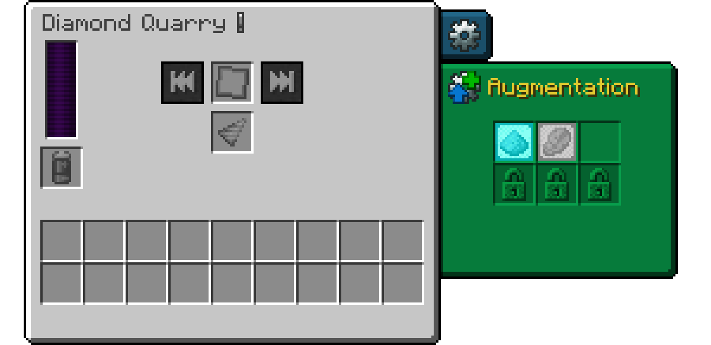
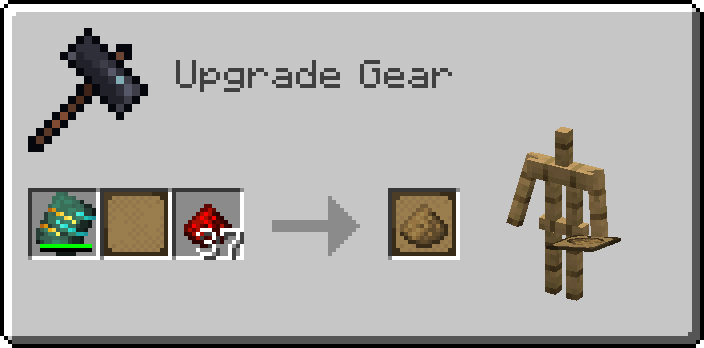

# Augments

Augments are upgrades that go into the Augmentation tab of the [quarry screen](quarries.md#the-quarry-screen). There are four kinds:

- The **Speed Augment** makes the quarry mine faster.
- The **Fortune Augment** gives more drops, like the Fortune enchantment.
- The **Silk Touch Augment** mines blocks as they are, like Silk Touch.
- The **Chest Looting Augment** empties chests and other containers in the area.

You fill Speed and Fortune Augments yourself; the other two are bought or found. How many augments a quarry can use depends on its tier (see [The six tiers](quarries.md#the-six-tiers)). Several augments of the same kind add up.

An augment's tooltip shows the values of your game: what it does (`+6.65 Speed factor`), what it costs (`+10.57 Speed energy factor`) and how full it is (`Used 512/1000 enhancements`). In your recipe viewer, press U on an Empty Augment to see every item that fills it.

> [!NOTE]
> Modpacks can change almost everything on this page: the items that fill augments, how strong augments get, the limits, and how Silk Touch and Chest Looting are obtained. They can also turn augments off. The numbers below are the defaults.

## Speed and Fortune Augments

Speed and Fortune Augments start as an Empty Augment. You fill it at a Smithing Table with an Augmenting Template. The recipes for both are on the [Crafting Recipes](crafting.md#augments) page.

### Filling an augment

Put the Augmenting Template into the template slot, the augment into the base slot and a stack of enhancers into the addition slot. Taking out the result uses up as many enhancers as fit into the augment and wears down the template.

The first enhancer decides the kind of augment: a speed enhancer makes a Speed Augment, a fortune enhancer a Fortune Augment. After that, the augment only accepts enhancers of its kind. Enhancers come in three tiers, and the tier decides how many points one item adds:

| Tier | Points per item | Speed enhancer | Fortune enhancer |
|---|---|---|---|
| 1 | 1 | Redstone Dust | Lapis Lazuli |
| 2 | 9 | Block of Redstone | Block of Lapis Lazuli |
| 3 | 81 | Core of Redstone | Core of Lapis Lazuli |

The recipes for the Cores are on the [Crafting Recipes](crafting.md#cores) page. The points per tier are fixed. Modpacks can only change which items belong to a tier. An enhancer only goes in if all of its points fit, so top off an almost full augment with smaller enhancers. In the tooltip, the points are called "enhancements".

### The Augmenting Template

The template loses one point of durability per augment point it adds. A new template holds 18,300 points, and its tooltip shows what is left. At zero it breaks.

The Celestial Augmenting Template never breaks. It is made from an Augmenting Template at a Smithing Table (see [Crafting Recipes](crafting.md#augments)).

### Capacity upgrades

A new augment has room for 1,000 points (Speed) or 1,500 points (Fortune). Capacity upgrades make room for more. Each augment has seven capacity slots, and each slot needs a specific item:

| Slot | Default item | Where to get it |
|---|---|---|
| 1 | Block of Diamond | Mining |
| 2 | Nautilus Shell | Fishing, Drowned, Wandering Traders |
| 3 | Echo Shard | Ancient City chests |
| 4 | Flow Armor Trim Smithing Template | Ominous Vaults in Trial Chambers |
| 5 | Enchanted Golden Apple | Structure chests |
| 6 | Nether Star | The Wither |
| 7 | Deepslate Emerald Ore | Mountains, mined with Silk Touch |

To add one, put the Augmenting Template, the augment and the item into a Smithing Table. The item fills the first free slot that accepts it, and the template loses one point of durability. Capacity upgrades can be added at any time, even to an Empty Augment. Points already inside stay.

Hold Shift on an augment to see its seven slots. Filled slots show their item. Empty slots cycle through the items they accept in your game. An empty slot that shows nothing has been left out by your modpack and can't be filled.

Room per number of capacity upgrades (defaults):

| Capacity upgrades | 0 | 1 | 2 | 3 | 4 | 5 | 6 | 7 |
|---|---|---|---|---|---|---|---|---|
| Speed Augment | 1,000 | 2,120 | 4,360 | 7,720 | 12,200 | 17,800 | 24,520 | 32,360 |
| Fortune Augment | 1,500 | 3,180 | 6,540 | 11,580 | 18,300 | 26,700 | 36,780 | 48,540 |

A completely filled augment with all seven capacity upgrades has a rainbow name.

## Speed Augment

The quarry's speed factor starts at 1, and each Speed Augment adds to it. The first points of an augment help the most, the last points of a large augment the least. Values of a completely filled Speed Augment with the default settings:

| Capacity upgrades | 0 | 1 | 2 | 3 | 4 | 5 | 6 | 7 |
|---|---|---|---|---|---|---|---|---|
| Speed factor | +1.17 | +2.34 | +4.31 | +6.65 | +9.01 | +11.22 | +13.22 | +15.00 |
| Speed energy factor | +1.22 | +2.63 | +5.64 | +10.57 | +17.40 | +25.75 | +35.11 | +45.00 |

For example, a Gold Quarry mines one block per second by default. One full Speed Augment with three capacity upgrades raises its speed factor to 1 + 6.65 = 7.65, so it mines 7.65 blocks per second.

Smaller augments use energy more efficiently. Without capacity upgrades, a full augment's speed energy factor is about 1.04 times its speed factor. With all seven, it is 3 times.

By default the speed factor of a quarry can't go above 93.71, which is exactly six full Speed Augments plus a drill with Efficiency V. Speed above the limit does nothing and costs no energy, and the quarry shows a yellow warning that names the limit.

## Fortune Augment

The Fortune Augment gives the quarry a Fortune level, like the Fortune enchantment on a pickaxe, so ores like coal, diamond, lapis and redstone drop more. Values of a completely filled Fortune Augment with the default settings:

| Capacity upgrades | 0 | 1 | 2 | 3 | 4 | 5 | 6 | 7 |
|---|---|---|---|---|---|---|---|---|
| Fortune level | +0.46 | +0.89 | +1.58 | +2.33 | +3.04 | +3.68 | +4.23 | +4.70 |
| Fortune energy factor | +0.19 | +0.38 | +0.67 | +0.99 | +1.29 | +1.56 | +1.80 | +2.00 |

A fractional level works as a chance: at Fortune 4.7, each block is mined with Fortune IV and has a 70% chance to be mined with Fortune V instead.

By default the Fortune level of a quarry can't go above 4.7. Fortune above the limit does nothing and costs no energy, and the quarry shows a yellow warning that names the limit. The energy cost grows evenly with the level. At 4.7 the quarry uses about three times the energy for about three times the ores.

## Energy factors

Speed and Fortune both raise the quarry's energy use. Their tooltips show this as energy factors. All speed energy factors add up, starting at 1, and so do all fortune energy factors. The quarry's base usage is then multiplied by both totals.

For example, a Diamond Quarry uses 270 RF/t by default. With two Speed Augments of +5.64 each and one Fortune Augment of +0.99, the speed energy factor is 1 + 5.64 + 5.64 = 12.28 and the fortune energy factor is 1 + 0.99 = 1.99. The quarry then uses 270 × 12.28 × 1.99 ≈ 6,598 RF/t. The quarry's tooltip and info icon always show the result, so there is no need to calculate it.

## Silk Touch Augment

The quarry mines blocks as they are, like a pickaxe with Silk Touch: stone stays stone, ores stay ores.

The quarry also mines more slowly, by default at half speed. The augment's tooltip shows the factor, for example `Takes 2-times longer per operation`. The energy use per tick stays the same, so each block costs more energy. Silk Touch also turns off Fortune: Fortune Augments in the same quarry have no effect, and the quarry shows a yellow warning.

By default, Toolsmiths from level 3 (Journeyman) and Wandering Traders can sell the augment for 40 to 64 Emeralds plus 3 to 7 Supreme Circuit Boards. Modpacks can change the price and the sellers, or turn the trade off.

## Chest Looting Augment

Normally the quarry skips chests and other containers. With this augment, it takes the items out of them and puts them into its output. This works on chests, trapped chests, barrels, shulker boxes, hoppers, dispensers, droppers and crafters, and on containers from other mods that are built the same way. Each item counts as one operation and costs energy like a mined block. The container itself stays in place, and locked containers are skipped.

By default the augment can be found in chests of these structures (modpacks can change this):

| Chance | Structures |
|---|---|
| 26% | Woodland Mansion, Ancient City |
| 12% | Stronghold (corridor, crossing, library), big Underwater Ruin, Pillager Outpost |
| 5% | Mineshaft, Desert Pyramid, Igloo, Jungle Temple, Dungeon, Shipwreck (treasure), small Underwater Ruin, Village (weaponsmith, armorer, toolsmith) |

With the [Lootr](compatibility.md#lootr) mod, each player has their own loot in a loot chest, and the quarry takes the loot of its owner. A Lootr chest only gets looted after a player has explored the area around it. Lootr turns loot chests into Lootr chests only while the 5 × 5 chunks around them are loaded. Until then, the quarry skips them.

> [!CAUTION]
> The augment also empties containers that players placed inside the area. Don't run a quarry with it over your own storage.

## Warnings

Augments can cause four yellow warnings: speed above the limit, fortune above the limit, Silk Touch together with Fortune, and augments in locked slots. None of them stop the quarry. See [Warnings and Troubleshooting](warnings.md#yellow-warnings).

---

[← Drills](drills.md) · [Overview](README.md) · [Expansion Cards →](expansion-cards.md)
