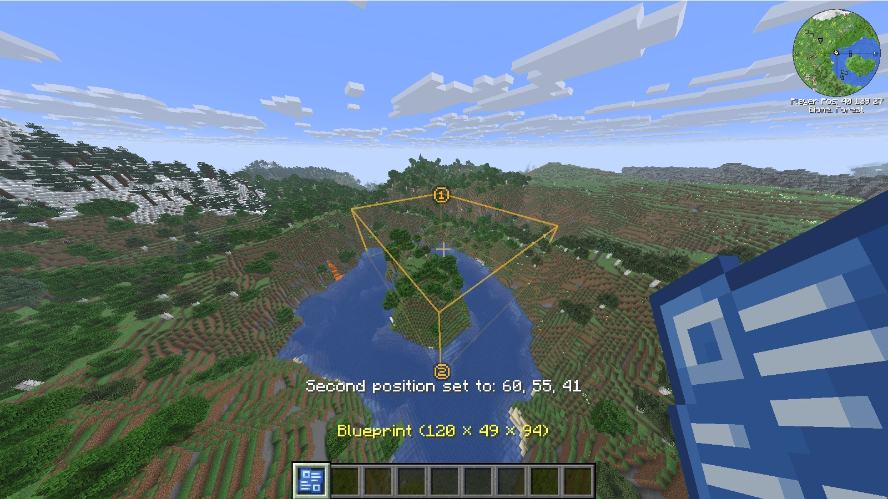
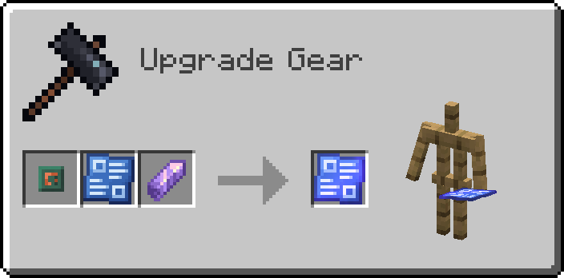

# Blueprints

A Blueprint tells a quarry which area to mine. You mark two corners of a box, seal the Blueprint and put it into the quarry. The Blueprint also stores how far the quarry has come.

Blueprints are crafted at a Crafting Table (see [Crafting Recipes](crafting.md#blueprints)).

## Marking the area

Hold the Blueprint in your main hand and look at a block up to 256 blocks away:

- Left-click sets the first corner.
- Right-click sets the second corner.
- Sneak and turn the mouse wheel to move one side of the box.
- Sneak, Sprint and turn the mouse wheel to move it 16 blocks per step.

A message above the hotbar confirms each new corner. If you keep the mouse button pressed, the corner follows the block you are looking at. Hold Shift on the Blueprint to see these controls in its tooltip.

The area is the box between the two corners, corners included. There is no size limit.

### Moving one side of the box

Sneak and turn the mouse wheel to move the side of the box you are looking toward. Looking north and scrolling forward moves the north side further north, and scrolling back moves it back. Looking down moves the bottom, looking up moves the top.

If the Blueprint has no corners yet, scrolling starts a box at your position.

> [!TIP]
> To make the area reach the bottom of the world, look down, hold Sneak and Sprint, and scroll until the box is deep enough.

### Seeing the area

While you hold a Blueprint, the outline of its area is drawn in the world, with the corners marked 1 and 2 (a single marker if both corners are the same block). The outline also appears while you hold a quarry item that contains a Blueprint, or a linked [Quarry Monitor](quarry-monitor.md).

## Sealing

A quarry only accepts a sealed Blueprint, which can no longer be changed by clicking. At a Smithing Table, put a Lesser Circuit Board into the template slot, a Blueprint with both corners set into the base slot and an Amethyst Shard into the addition slot. These are the default ingredients. Your recipe viewer shows the ones your game uses.

A Sealed Blueprint lying on the ground can't be destroyed by lava, fire, cacti or explosions.

## How the quarry works through the area

The quarry mines the area one chunk at a time. It starts with the chunk in the north-west corner of the area (lowest X and Z), goes east chunk by chunk until the row is done, then moves one row south and starts again in the west. Inside each chunk it only mines the part that lies inside the area. The order inside a chunk is explained under [Mining pattern cards](expansion-cards.md#mining-pattern-cards).

The Blueprint's tooltip shows the progress, for example `Progress: 3/12 Chunk(s) (25%)`. Once a chunk is done, a golden bar appears on the item.

The Previous Chunk and Next Chunk buttons in the [quarry screen](quarries.md#the-quarry-screen) jump back or skip ahead. This changes the progress stored in the Blueprint.

## Finished Blueprints

When all chunks are mined, the Blueprint's name ends with `(Completed)` and the quarry stops. To reuse the Blueprint, put it into a Grindstone. This unseals it and resets its progress. The corners stay, so you can adjust them and seal it again.

## Dimensions

A Blueprint belongs to the dimension in which its corners were set, and its tooltip shows that dimension. Mining an area in another dimension is explained under [Interdimensional Expansion Card](expansion-cards.md#interdimensional-expansion-card).

---

[← Quarries](quarries.md) · [Overview](README.md) · [Drills →](drills.md)
