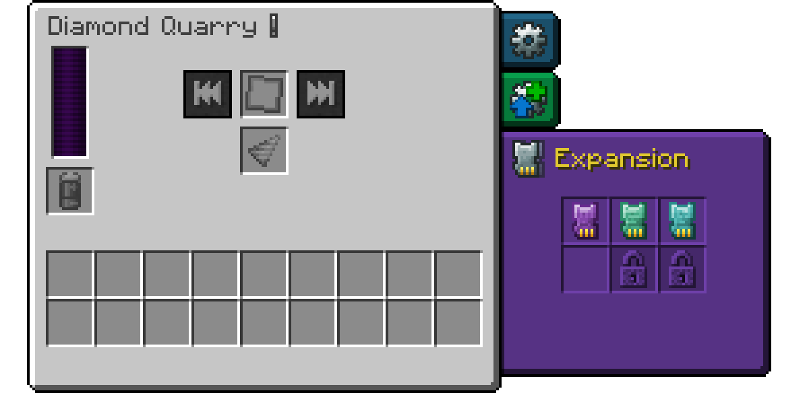
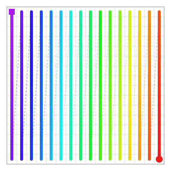
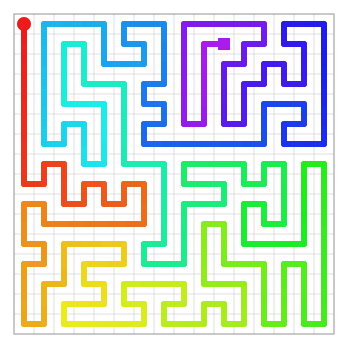
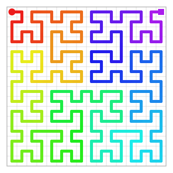

# Expansion Cards

Expansion cards give a quarry new abilities. They go into the Expansion tab of the [quarry screen](quarries.md#the-quarry-screen). Unlike augments, they cost no energy and have no downsides.

How many cards a quarry can use depends on its tier (see [The six tiers](quarries.md#the-six-tiers)).

## Blank Expansion Card

The Blank Expansion Card is the base for crafting other cards and can't be used in a quarry itself. Its recipe is on the [Crafting Recipes](crafting.md#expansion-cards) page.

## Interdimensional Expansion Card

Without this card, a quarry only mines in its own dimension. With it, the quarry also mines Blueprint areas in other dimensions, for example an area in the Nether from a quarry in the Overworld.

The Blueprint decides the dimension: mark the area in the dimension you want to mine, seal the Blueprint and bring it back to the quarry. The coordinates are those of that dimension and are not converted like portal coordinates. Without the card, a quarry with a Blueprint from another dimension stops with the warning `⚠ Can't mine in other dimensions`.

The card's recipe is on the [Crafting Recipes](crafting.md#expansion-cards) page.

> [!NOTE]
> Modpacks and servers can turn the card off. Quarries then only mine in their own dimension. Servers can also forbid mining in some dimensions altogether, with or without the card (see [Configuration](configuration.md#dimensions)).

## Mining pattern cards

Without a pattern card, a quarry digs each chunk column by column: one column from top to bottom, then the next. A pattern card makes it dig layer by layer instead. Each layer follows a path, and the next layer starts right below the block where the last one ended.

- The **Snake Pattern Expansion Card** follows a random winding path, different in every layer. By default, Cartographers at level 5 (Master) sell it for 32 to 48 Emeralds plus a Blank Expansion Card.
- The **Gilbert Pattern Expansion Card** follows a space-filling curve that covers the layer square by square. By default, it can be found in Ancient City and End City treasure chests, with a 5% chance each.

| Default | Snake | Gilbert |
|:---:|:---:|:---:|
|  |  |  |

The images show a chunk from above, with north at the top. The line runs from red (start, dot) to violet (end, square). Without a card, each point is a whole column. With a pattern card, the line is one layer.

Pattern cards don't change what the quarry mines, how fast it mines or how much energy it uses.

If a quarry has two or more different pattern cards, the patterns take turns from chunk to chunk. With two patterns, the chunks form a checkerboard. Each chunk always gets the same pattern, no matter where the Blueprint starts. Two copies of the same card count as one.

Pattern cards work immediately. When you insert or remove one, the quarry starts the current chunk again from the top with the new pattern. Blocks that are already mined stay mined, so no work is lost.

> [!NOTE]
> Modpacks can change the price and sellers of the Snake Pattern Expansion Card or turn its trade off, and change where the Gilbert Pattern Expansion Card can be found.

## Warnings

Three warnings have to do with expansion cards. `⚠ Can't mine in other dimensions` and `⚠ Mining is disabled in the blueprint's dimension` stop the quarry. `⚠ Expansion Cards in locked slots are ignored` doesn't. See [Warnings and Troubleshooting](warnings.md).

---

[← Augments](augments.md) · [Overview](README.md) · [Quarry Monitor →](quarry-monitor.md)
