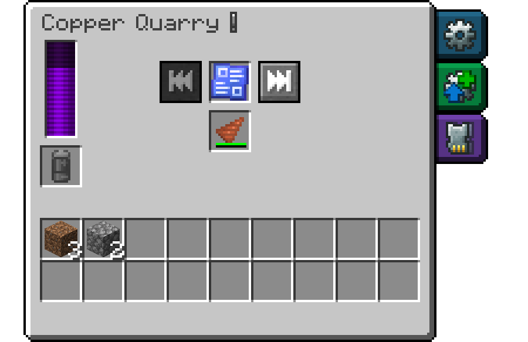

# Getting Started

This page walks you through your first quarry. You need a mod that produces energy (RF or FE), for example generators or solar panels. Iron Quarry doesn't produce energy itself.

> [!NOTE]
> The recipes mentioned here are the mod's defaults. Modpacks often change recipes, so if one doesn't work, look the item up in your recipe viewer (JEI or REI). All default recipes are listed on the [Crafting Recipes](crafting.md) page.

## 1. Circuit boards

Almost every item in this mod needs circuit boards. Start with Blank Circuit Boards, crafted from Dark Prismarine, Copper Ingots and Amethyst Shards. One craft gives 16. Then craft one Blank Circuit Board with Copper Ingots and Redstone Dust into four Lesser Circuit Boards. Better quarries need better circuit boards later on. You can find the whole chain on the [Crafting Recipes](crafting.md#circuit-boards) page.

## 2. Quarry, drill and Blueprint

A quarry needs three things, all made with Lesser Circuit Boards:

- the **Copper Quarry**, the first of six quarry tiers,
- the **Copper Drill**, which the quarry uses like a pickaxe,
- a **Blueprint**, which tells the quarry which area to mine.

## 3. Mark the area

Hold the Blueprint in your main hand, look at a block up to 256 blocks away and left-click to set the first corner. Look at another block and right-click to set the second corner. The two corners span a box, and you see its outline while you hold the Blueprint.

The quarry mines everything inside the box, corners included, from the top layer down to the bottom layer. Make sure the box reaches as deep as you want to dig.

> [!TIP]
> To grow or shrink the box without clicking new corners, hold Sneak and turn the mouse wheel. This moves the side of the box you are looking toward. Hold Sprint as well to move it 16 blocks per step. [Blueprints](blueprints.md) has more details.

## 4. Seal the Blueprint

A quarry only accepts a sealed Blueprint, so the area can't change by accident. At a Smithing Table, put a Lesser Circuit Board into the template slot, the Blueprint into the base slot and an Amethyst Shard into the addition slot.

## 5. Place and fill the quarry

Place the quarry anywhere. It doesn't have to stand next to the area. Right-click it to open its screen, then put the Sealed Blueprint into the Blueprint slot and the drill into the Drill slot (3 and 4 in the [picture of the quarry screen](quarries.md#the-quarry-screen)).

## 6. Connect energy

Connect a cable or a generator to any side of the quarry. You can also put a charged battery from another mod into the battery slot. The quarry drains it and moves it to the output once it is empty.

As soon as there is enough energy, the quarry starts mining.

## 7. Collect the items

Mined items go into the quarry's output inventory, which has 18 slots. Take them out by hand, or let the quarry push them into a chest or pipe as described in [Side settings](quarries.md#side-settings-io). When the output is full, the quarry stops and waits.

## Things to keep in mind

- The quarry only works while its own chunk is loaded. It loads the chunks it mines by itself, but if you walk far away from the quarry, it pauses. A chunk loader from another mod can keep it running.
- The player who places a quarry owns it, and the quarry may only break blocks that its owner may break. In someone else's land claim it stops. See [Ownership and land claims](quarries.md#ownership-and-land-claims).
- By default, the Copper Drill gets the same drops as a stone pickaxe. Diamond, gold, emerald and redstone ore are mined but drop nothing. Switch to an Iron Drill before mining where those ores are. See [Drills](drills.md#mining-level).
- If the quarry stops, hover over the info icon (the "!" next to its name) in the quarry screen. [Warnings and Troubleshooting](warnings.md) explains each warning.

## Next steps

A better [quarry tier](quarries.md#the-six-tiers) mines faster, and when you upgrade, everything inside moves to the new quarry. [Augments](augments.md) make it even faster or give more ores. The Copper Quarry has no augment slots by default, so you need at least an Iron Quarry for them. A [Quarry Monitor](quarry-monitor.md) lets you watch the quarry from far away.

---

[Overview](README.md) · [Quarries →](quarries.md)
