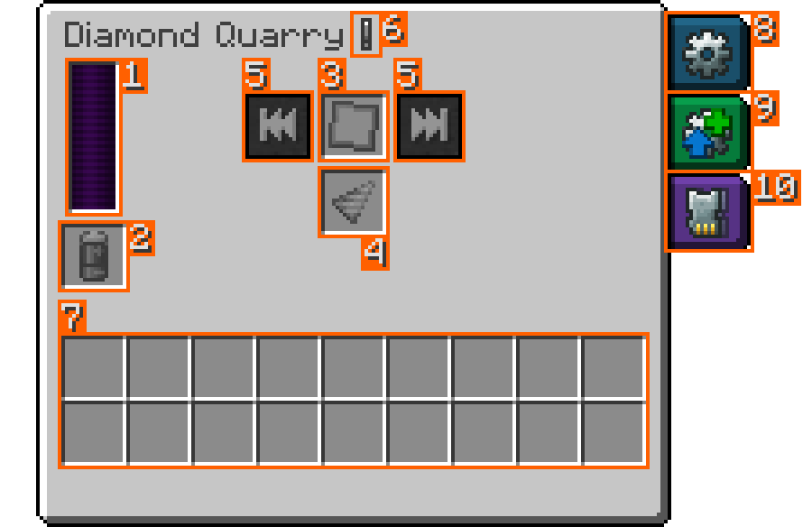
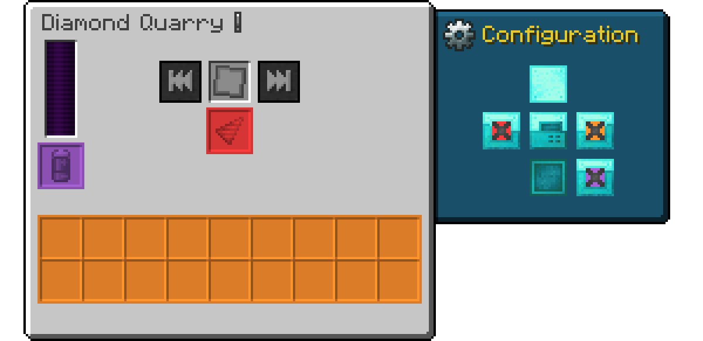

# Quarries

A quarry mines every block in the area of its [Blueprint](blueprints.md), one chunk after another, and collects the drops in its inventory. To run, it needs a sealed Blueprint, a drill and energy.

## The six tiers

Higher tiers mine faster and have more slots for [augments](augments.md) and [expansion cards](expansion-cards.md), but use more energy per block. Default values without augments:

| Quarry | Blocks per second | Energy per block | Energy while mining | Energy capacity | Augment slots | Expansion slots |
|---|---|---|---|---|---|---|
| Copper Quarry | 0.5 | 800 RF | 20 RF/t | 20,000 RF | 0 | 1 |
| Iron Quarry | 0.67 | 1,200 RF | 40 RF/t | 100,000 RF | 1 | 2 |
| Gold Quarry | 1 | 1,800 RF | 90 RF/t | 500,000 RF | 2 | 3 |
| Diamond Quarry | 2 | 2,700 RF | 270 RF/t | 2,500,000 RF | 3 | 4 |
| Netherite Quarry | 4 | 4,050 RF | 810 RF/t | 10,000,000 RF | 4 | 5 |
| Nether Star Quarry | 10 | 6,080 RF | 3,040 RF/t | 50,000,000 RF | 6 | 6 |

> [!NOTE]
> Modpacks and servers can change all of these values (see [Configuration](configuration.md#quarries)). The tooltip of a quarry shows the values of your game including its augments: `Usage` (energy per tick, or per block while holding Shift), `Speed` in operations per second, and `Fortune`. With Shift it also shows the `Energy capacity`.

### Upgrading and moving a quarry

Each tier is crafted from the one before it (see [Crafting Recipes](crafting.md#quarries)). The new quarry keeps everything from the old one: items, Blueprint, drill, augments, expansion cards, stored energy and side settings.

A quarry also keeps its contents when you pick it up, so you can move a running setup somewhere else. Break it with any pickaxe, or sneak and right-click it with a wrench from another mod.

> [!CAUTION]
> A quarry broken without a pickaxe, for example by hand, is destroyed together with everything inside.

## The quarry screen

Right-click a quarry to open its screen.

1. **Energy bar.** Hover over it to see the stored energy.
2. **Battery slot.** Takes a charged energy item from another mod. The quarry drains it and moves it into the output once it is empty.
3. **Blueprint slot.** Takes a sealed [Blueprint](blueprints.md).
4. **Drill slot.** Takes a [drill](drills.md).
5. **Previous Chunk and Next Chunk.** Jump back or skip ahead to another chunk of the Blueprint area, for example when the quarry is stuck on a chunk it can't mine.
6. **Info icon.** Hover over it to see the owner, the current usage, speed and fortune, and all [warnings](warnings.md). It blinks red or yellow while there is a warning.
7. **Output inventory.** Everything the quarry mines ends up in these 18 slots.
8. **Configuration tab** with the [side settings](#side-settings-io).
9. **Augmentation tab** with six slots for [augments](augments.md).
10. **Expansion tab** with six slots for [expansion cards](expansion-cards.md).

Tabs open when you move the mouse over them and close when you move it away.

Slots that the quarry's tier can't use show a lock. They open up when you upgrade the quarry. An augment or card left in a locked slot, for example after a server lowered the slot count, has no effect, and the quarry shows a yellow warning. You can still take it out.

> [!TIP]
> Holding Shift while hovering over a quarry item shows a small preview of its Blueprint, drill, augments and expansion cards.

## Energy

The quarry accepts energy from every side and from the battery slot. Which energy mods work is listed under [Compatibility](compatibility.md#energy). It only mines while it has enough energy for at least one block. Speed and Fortune Augments raise the energy use. The tooltip and the info icon always show the current usage.

## Side settings (IO)

Each side of the quarry can be connected to one of its inventories, so that pipes, hoppers and other mods can use it:

- **Orange** connects the output inventory. The quarry pushes mined items out of this side into the block next to it, such as a chest or a pipe. Pipes can also pull items out.
- **Red** connects the Drill slot, so pipes can insert new drills.
- **Purple** connects the battery slot, so pipes can insert charged batteries.

All sides are closed by default.

To change a side, open the Configuration tab. It shows the six sides of the quarry around its front. Left-click a side to switch to the next color, right-click to go back. While the tab is open, the screen shows each inventory in its color. You can also right-click a side of the placed quarry with a wrench from another mod. Most wrenches work.

## What the quarry mines

The quarry works through its Blueprint area one chunk at a time. The order of the chunks is explained under [How the quarry works through the area](blueprints.md#how-the-quarry-works-through-the-area), the order inside a chunk under [Mining pattern cards](expansion-cards.md#mining-pattern-cards).

It removes every normal block and puts the drops into its output. Water and lava are removed too. Source blocks cost as much energy as a block, flowing liquid costs nothing, and neither gives items.

It skips and leaves in place:

- blocks that can't be broken in survival, like bedrock,
- blocks on its skip list, which by default contains every block the Wither can't break, such as reinforced deepslate (modpacks can add more, see [Data Packs and Tags](data-packs.md#blocks)),
- blocks that store data, like chests, furnaces, signs and spawners. With the [Chest Looting Augment](augments.md#chest-looting-augment) it empties containers that hold items, but still leaves the block.

A block that needs a better tool than the drill is still removed, but drops nothing (see [Mining level](drills.md#mining-level)).

When the output inventory is full, the quarry waits. It never drops items on the ground.

## Chunk loading

The quarry keeps the chunk it is mining and the next one loaded by itself, so you don't need to stay near the area.

While the quarry waits for energy, for space in its output or for a protected block, it keeps these two chunks loaded. It releases them about a second after it stops for good, for example when you take out the Blueprint or its own chunk unloads.

> [!IMPORTANT]
> The quarry itself is not kept loaded. It only works while its own chunk is loaded, for example because you are nearby or because a chunk loader from another mod keeps it loaded.

## Ownership and land claims

The player who places a quarry becomes its owner. The info icon shows the owner's name. The quarry breaks blocks as if its owner did it, so claim and protection mods check the owner's rights.

If the owner may not break a block, for example in someone else's claim, the quarry stops with the warning `⚠ Not allowed to mine at X, Y, Z` and tries again every 5 seconds. [Warnings and Troubleshooting](warnings.md#red-warnings) explains how to get past such a block.

A quarry without an owner doesn't mine. This can happen when a machine from another mod places it. The quarry then shows `⚠ Quarry has no owner; place it again`.

## Common questions

**Does the quarry need to be next to the area?** No, it can stand anywhere in the same dimension. Mining in other dimensions needs an [Interdimensional Expansion Card](expansion-cards.md#interdimensional-expansion-card).

**How do I restart the current chunk?** Take the Blueprint out and put it back in. The quarry starts the current chunk again from the top.

**How can I see where the quarry is digging?** See [Seeing the area](blueprints.md#seeing-the-area). A [Quarry Monitor](quarry-monitor.md#in-the-world) also marks the block that is being mined.

---

[← Getting Started](getting-started.md) · [Overview](README.md) · [Blueprints →](blueprints.md)
