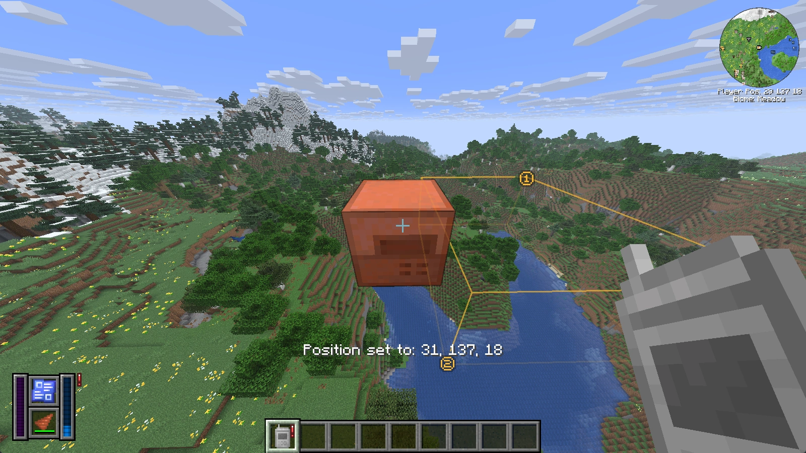

# Quarry Monitor

A Quarry Monitor shows the state of one quarry from far away: its energy, how full its output is, its Blueprint and drill, and any warnings.

## The four monitors

Each monitor is crafted from the one before it and stays linked to the same quarry (see [Crafting Recipes](crafting.md#quarry-monitors)).

Default values:

| Monitor | Range | Other dimensions |
|---|---|---|
| Iron Quarry Monitor | 1,024 blocks | no |
| Diamond Quarry Monitor | 4,096 blocks | no |
| Netherite Quarry Monitor | 16,384 blocks | yes |
| Sculk Quarry Monitor | 65,536 blocks | yes |

Only the horizontal distance counts. In another dimension the distance is converted like portal coordinates, so in the Nether one block counts as eight.

> [!NOTE]
> Modpacks and servers can change the ranges and which monitors reach other dimensions (see [Configuration](configuration.md#monitors)). A monitor's tooltip shows its `Update range` and says `Works across dimensions` if it reaches other dimensions.

## Linking

Hold the monitor in your main hand and right-click a quarry. The message `Position set to: …` confirms the link. Right-clicking another quarry links the monitor to that one instead.

The monitor updates by itself while it is in your inventory: once per second, or five times per second while you hold it. If the quarry is out of range or its chunk isn't loaded, the monitor shows a warning instead.

## Monitor display

While a linked monitor is in your inventory, a small display appears on your screen. If you carry several monitors, it shows the first one. The left bar shows the stored energy, the right bar how full the output is, and in between are the Blueprint and the drill with its durability. A red or yellow "!" next to the display means there is a warning. You can change the display's corner and position in the [client config](configuration.md#client-config).

## Tooltip

The monitor's tooltip shows its range, when it was last updated and the current [warnings](warnings.md) of the quarry. While you hold Shift, the monitor shows the linked quarry instead: its icon, name and tooltip, with usage, speed, fortune, stored energy and a preview of its contents.

A small "!" on the monitor's icon shows a warning even without hovering, in the color of the [warning](warnings.md). The bar under the icon shows the progress of the quarry's Blueprint.

## In the world

While you hold the monitor, the quarry is drawn at its position so you can find it from far away, and the outline of its Blueprint area is shown. A blue "i" marks the block being mined right now, and a red "!" with the distance marks a block the quarry is not allowed to mine (see [Ownership and land claims](quarries.md#ownership-and-land-claims)).

In the picture below, the quarry has run out of energy, so the display and the icon show a red "!" (see [Monitor display](#monitor-display) and [Tooltip](#tooltip)).

## Warnings

Besides the quarry's warnings, a monitor has two of its own: the red `⚠ Quarry unloaded or destroyed` and the yellow `⚠ Quarry out of range`. See [Warnings and Troubleshooting](warnings.md).

---

[← Expansion Cards](expansion-cards.md) · [Overview](README.md) · [Warnings and Troubleshooting →](warnings.md)
