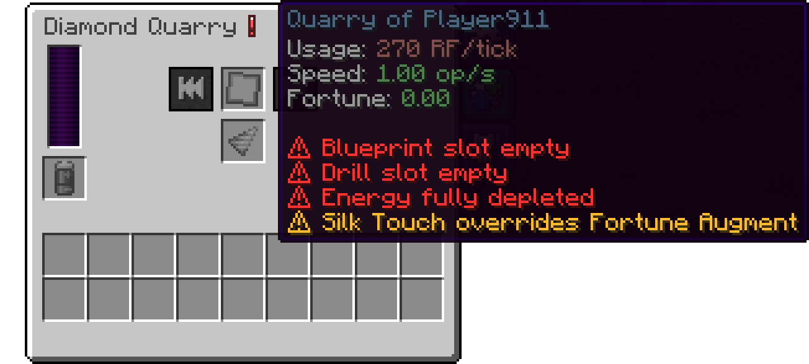

# Warnings and Troubleshooting

A quarry shows warnings when something is wrong. To see them, hover over the info icon in the quarry screen (the "!" next to the quarry's name). A linked [Quarry Monitor](quarry-monitor.md) shows them as well, in its tooltip and display.

Red warnings mean the quarry has stopped. Yellow warnings mean it still runs, but something needs attention.

## Red warnings

| Warning | Meaning | Fix |
|---|---|---|
| `⚠ Blueprint slot empty` | There is no Blueprint in the quarry. | Put a sealed [Blueprint](blueprints.md) into the Blueprint slot. |
| `⚠ Blueprint not sealed` | The Blueprint in the quarry isn't sealed. | Take it out and [seal it](blueprints.md#sealing). |
| `⚠ Drill slot empty` | There is no drill in the quarry, or it just broke. | Put a [drill](drills.md) into the Drill slot. |
| `⚠ Energy fully depleted` | There isn't enough energy for a single block. | Connect an energy source or insert a charged battery. See [Energy](quarries.md#energy). |
| `⚠ Output inventory full` | The next drop doesn't fit into the output inventory. | Empty the output, or let the quarry push items out of an orange side (see [Side settings](quarries.md#side-settings-io)). |
| `⚠ Can't mine in other dimensions` | The Blueprint is from another dimension. | Add an [Interdimensional Expansion Card](expansion-cards.md#interdimensional-expansion-card), or use a Blueprint from the quarry's own dimension. |
| `⚠ Mining is disabled in the blueprint's dimension` | The server doesn't allow quarries to mine in that dimension. | Use a Blueprint from another dimension. Server owners: see [Dimensions](configuration.md#dimensions). |
| `⚠ Not allowed to mine at X, Y, Z` | The owner may not break the block at that position, usually because of a land claim. Hold Shift to see the block. | Get permission in that claim, change the Blueprint area, or skip the chunk with Next Chunk. See [Ownership and land claims](quarries.md#ownership-and-land-claims). |
| `⚠ Quarry has no owner; place it again` | The quarry doesn't know who placed it, so it can't check any rights. | Pick the quarry up with a pickaxe or wrench and place it again by hand. Its contents stay inside. |
| `⚠ Quarry unloaded or destroyed` | Monitor only: the quarry's chunk isn't loaded, or the quarry is gone. | Go near the quarry, or keep its chunk loaded with another mod. |

## Yellow warnings

| Warning | Meaning | Fix |
|---|---|---|
| `⚠ Energy almost depleted \| <30%` | Less than 30% of the energy capacity is left. | Supply more energy, or the quarry will soon stop. |
| `⚠ Output inventory almost full \| >70%` | At least 70% of the output slots are in use. | Empty the output soon. |
| `⚠ Quarry out of range` | Monitor only: you are too far from the quarry, or it is in a dimension this monitor can't reach. | Come closer, or use a better [monitor](quarry-monitor.md#the-four-monitors). |
| `⚠ Speed Augments are limited to Speed factor ×…` | The quarry has more speed than allowed; the number in the warning is the limit. | Nothing breaks, the extra speed just does nothing. Remove an augment if you like. |
| `⚠ Fortune Augments are limited to Fortune …` | The quarry has more fortune than allowed; the number in the warning is the limit. | Nothing breaks, the extra fortune just does nothing. Remove an augment if you like. |
| `⚠ Silk Touch overrides Fortune Augment` | A Silk Touch Augment and a Fortune Augment are in the same quarry, so the Fortune Augment does nothing. | Remove one of them. |
| `⚠ Augments in locked slots are ignored` | An augment is in a slot this tier can't use. | Take it out or upgrade the quarry. |
| `⚠ Expansion Cards in locked slots are ignored` | A card is in a slot this tier can't use. | Take it out or upgrade the quarry. |

## Problems without a warning

**The quarry does nothing, but shows no warning.** Check whether the quarry's own chunk is loaded (see [Chunk loading](quarries.md#chunk-loading)) and whether the Blueprint is finished (see [Finished Blueprints](blueprints.md#finished-blueprints)).

**Some ores give no items.** The drill's mining level is too low for them. See [Mining level](drills.md#mining-level).

**The quarry leaves blocks behind.** That is intended. [What the quarry mines](quarries.md#what-the-quarry-mines) lists the blocks it skips.

**The quarry stays on one chunk for a long time.** A large area can be very deep; the Blueprint's tooltip shows the progress. If a chunk can't be mined at all, for example because of a claim, use Next Chunk.

**The quarry got much slower after adding an augment.** That is probably a [Silk Touch Augment](augments.md#silk-touch-augment), which makes the quarry slower.

**Items don't come out of the connected side.** Check the side's setting in the Configuration tab (see [Side settings](quarries.md#side-settings-io)).

## Modpack and server differences

**An item shows `<This item is disabled by server config>`.** The modpack or server has turned it off (see [Playing a modpack or on a server](README.md#playing-a-modpack-or-on-a-server)).

**A recipe from this documentation doesn't work.** Your modpack uses a different recipe. Your recipe viewer (JEI or REI) shows the recipes of your game.

**No villager sells the Silk Touch Augment or the Snake Pattern Expansion Card.** Villagers offer these trades only by chance, once they reach the matching level. The modpack or server may also have turned the trade off or given it to other villagers.

**The numbers in my game differ from this documentation.** This documentation shows the default values. [Playing a modpack or on a server](README.md#playing-a-modpack-or-on-a-server) lists where the game shows yours.

---

[← Quarry Monitor](quarry-monitor.md) · [Overview](README.md) · [Crafting Recipes →](crafting.md)
